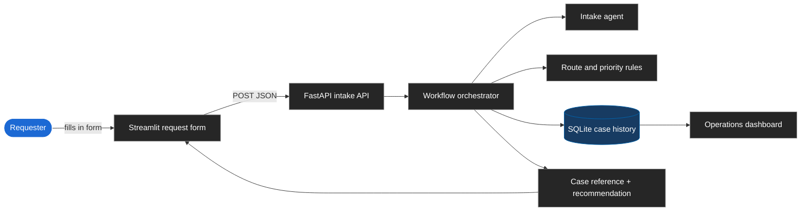
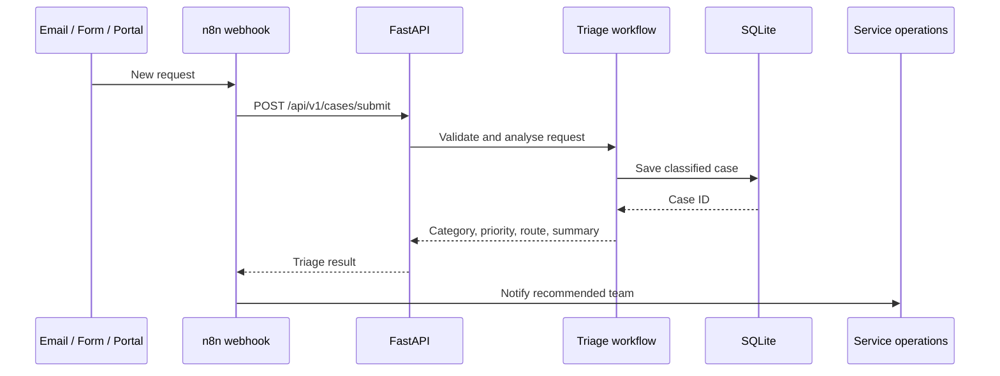

# AI-assisted Workflow Automation

An end-to-end service-request triage demo. A person submits a request in a
simple web form, the workflow classifies it, estimates urgency, recommends an
owner, stores the case, and shows the result in an operations dashboard.

## Live demo

Run the demo locally:

```bash
git clone https://github.com/HarithNorani/AI-assisted-workflow-automation.git
cd AI-assisted-workflow-automation
python3 -m venv .venv
source .venv/bin/activate
pip install -r requirements.txt
```

Start the API in one terminal:

```bash
uvicorn app.api:app --reload
```

Start the dashboard in a second terminal:

```bash
streamlit run dashboard.py
```

Then open:

- **Request form and operations dashboard:** <http://127.0.0.1:8501>
- **API health check:** <http://127.0.0.1:8000/health>
- **Interactive API docs:** <http://127.0.0.1:8000/docs>

The dashboard is the easiest entry point for a non-technical user. Open
**Submit a service request**, complete the fields, and select **Submit
request**. The new case is classified immediately and appears in the recent
cases table.

> This repository provides a local live demo. It does not currently include a
> public hosted deployment or production credentials.

## What it does

| Step | What happens | Result |
| --- | --- | --- |
| 1. Intake | A requester describes an issue or asks for help | A validated service request |
| 2. Classification | The intake agent checks the description for technical, policy, inventory, or service signals | An issue category |
| 3. Prioritisation | Rules estimate urgency from the request language | Low, medium, or high priority |
| 4. Routing | The workflow recommends the responsible team | For example, `technical_support` |
| 5. Persistence | The case is stored in SQLite | A searchable case record |
| 6. Operations view | Streamlit reads the stored cases | Counts, routing signals, and case details |

The default demo runs without external AI credentials. It uses deterministic
heuristic classification so it is easy to run and test. An optional LLM route
suggestion layer can be enabled with environment configuration, but the demo
remains usable without it.

## How a request moves through the system



### Example outcome

A requester submits:

> “A critical integration fails after an update. Policy coverage review
> requested.”

The workflow produces a case with:

- **Category:** Policy case
- **Priority:** High
- **Assigned team:** Policy team
- **Confidence:** Based on matching request signals
- **Missing information:** Any required fields that were not supplied

## Optional n8n automation path

The included [`n8n/sample-workflow.json`](n8n/sample-workflow.json) shows how
an external automation trigger can use the same API. Instead of the Streamlit
form, n8n receives a webhook, submits the payload to FastAPI, and sends the
result to a service-operations Slack channel.



## Request fields

The web form and API accept:

| User-facing field | API field | Purpose |
| --- | --- | --- |
| Your name | `requester_name` | Identifies the person asking for help |
| Organization | `organization_name` | Identifies the service organization |
| Affected service or asset | `asset_name` | Names the affected item or service |
| Asset or reference ID | `asset_id` | Links the request to an internal reference |
| What do you need help with? | `request_type` | Captures the broad request type |
| Describe the issue or request | `issue_summary` | Supplies the text used for triage |

The API can also be called directly:

```bash
curl -X POST http://127.0.0.1:8000/api/v1/cases/submit \
  -H "Content-Type: application/json" \
  -d '{
    "organization_name": "Example Organization",
    "requester_name": "Anna Schneider",
    "asset_name": "Example Asset A",
    "asset_id": "ASSET-001",
    "issue_summary": "A critical integration fails after an update. Policy coverage review requested.",
    "request_type": "service_request"
  }'
```

## Architecture and project map

```text
app/
├── api.py          FastAPI endpoints and request validation
├── workflow.py     Orchestrates analysis, routing, and persistence
├── ai_agent.py     Deterministic intake classification and priority rules
├── llm_agent.py    Optional LLM-compatible route suggestion layer
├── database.py     SQLite schema and case queries
└── storage.py      SQLite/PostgreSQL storage adapter

dashboard.py        Streamlit request form and operational dashboard
n8n/                Example webhook → API → Slack workflow
backend-java/       Optional Spring Boot routing service
data/               Local SQLite database schema and runtime data
tests/              Automated workflow tests
```

## Tech stack

- **Python** for workflow orchestration and classification
- **FastAPI** for validated HTTP intake
- **SQLite** for local persistence
- **Streamlit** for the request form and operations dashboard
- **n8n** for optional external workflow orchestration
- **Java / Spring Boot** for the optional enterprise-style routing service
- **PostgreSQL** as an optional storage environment through Docker Compose

## Run tests

```bash
python3 -m pytest -q
```

## Optional services

Run the Java backend:

```bash
cd backend-java/workflow-automation-java
mvn spring-boot:run
```

Start the optional PostgreSQL container:

```bash
docker compose up -d postgres
```

## Next steps for production

- Deploy the API and dashboard behind HTTPS
- Replace local SQLite with managed PostgreSQL
- Add authentication and role-based access
- Add email, ticketing, and Slack integrations
- Add human approval for low-confidence routing
- Add operational KPIs such as response time and backlog age
